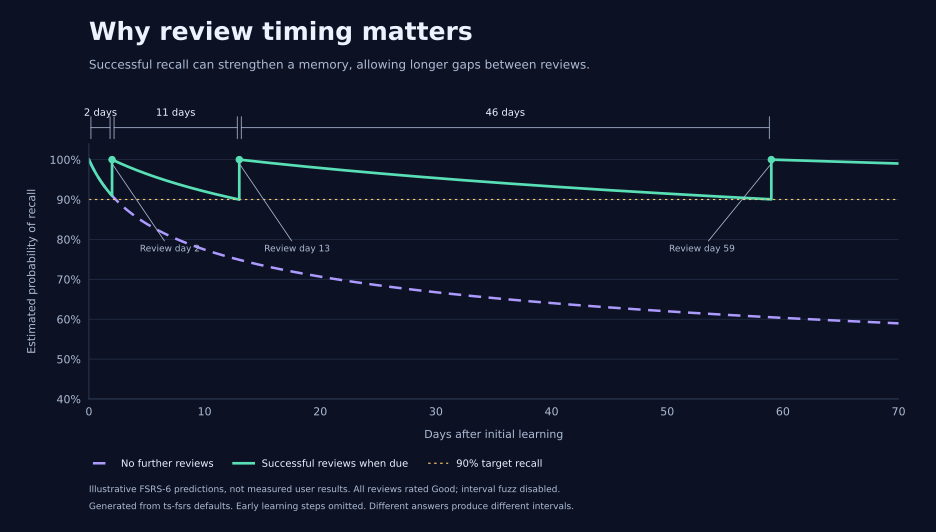
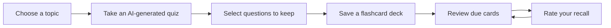

# SpacedRep

**Turn what you study into something you can recall later.**

SpacedRep combines flashcards, FSRS-6 review scheduling, and AI-generated quizzes. Build a deck, test your understanding, and return to cards when they are due for review.

**[Open SpacedRep →](https://spaced-repetition-app-ecru.vercel.app)**

## Why spaced repetition?

Understanding something today does not mean you will remember it next week. Without another attempt to recall it, that knowledge can become harder to retrieve. Reviewing everything every day becomes impractical as your study material grows.

Spaced repetition spreads recall practice over time. The goal is to revisit a card while you still have a reasonable chance of remembering it, then adjust the next review based on how well you recalled the answer. Research on [test-enhanced learning](https://pubmed.ncbi.nlm.nih.gov/16507066/) supports using retrieval practice to improve long-term retention.

*This graph uses the installed scheduler's default parameters and an example card rated Good at each scheduled review. After initial learning, its first three gaps are 2, 11, and 46 days. These are model predictions, not measured user results or a fixed schedule for every card.*

## How FSRS decides when to review

SpacedRep uses **FSRS-6**, the Free Spaced Repetition Scheduler, through [ts-fsrs](https://github.com/open-spaced-repetition/ts-fsrs). It maintains a memory state for each card:

| Measure | Meaning | What it helps determine |
|---|---|---|
| **Stability** | How long the model expects recall to take to fall to 90% after a review. | How far apart reviews can be. |
| **Difficulty** | How difficult the card is estimated to be. | How stability changes after a review. |
| **Retrievability** | The estimated probability of recalling the card now. | How recall changes as time passes. |

During a study session, try to answer before revealing the back of the card. Then choose **Again**, **Hard**, **Good**, or **Easy**. The scheduler updates the card's state and next due date. Successful reviews can extend the interval; forgetting can bring a card back sooner.

The forgetting curve follows the FSRS-6 model:

$$
R(t,S) = \left(1 + f\frac{t}{S}\right)^{-d}, \qquad f = 0.9^{-1/d} - 1
$$

Here, $t$ is time since the last review, $S$ is stability, and $d$ controls the shape of the decay. When $t = S$, estimated recall is 90%. See the [FSRS algorithm reference](https://github.com/open-spaced-repetition/awesome-fsrs/wiki/The-Algorithm) for the full model.

**In this app:** scheduling uses the library's default parameters and retention target. Card states change with your ratings; training a separate set of parameters for each user is not implemented. The displayed retention percentage is an estimate, rather than a direct measurement of what you know.

## What you can do

### Build and organize your study material

- Create decks and write question-and-answer flashcards.
- Generate an answer from a word, term, or question using AI.
- Extract text from an uploaded image into a card's answer.
- Edit or remove cards as your material changes.

### Review with feedback about your memory

- Study the cards currently due in a deck.
- Rate your recall to update each card's FSRS schedule.
- Expand a card to inspect its forgetting curve, stability, difficulty, review count, and lapses.
- See a session summary with your recall score and rating breakdown.
- Request an AI hint when you are stuck. Using a hint disables Good and Easy; taking more than 15 seconds disables Easy. These are interface rules intended to encourage careful self-rating.

### Turn a quiz into a flashcard deck

Choose a topic and difficulty to request a ten-question quiz: seven multiple-choice questions and three fill-in-the-blank questions. Multiple-choice answers use the answer key; written answers use AI-assisted semantic grading to assess wording beyond exact matches.

After the quiz, review your score and select the questions you want to keep. Saved questions become cards in a new deck with FSRS scheduling, connecting a one-off quiz to future review.

AI-generated questions, answers, and grades can contain mistakes. Check important material against your course notes or another trusted reference.

## Best used for

| Use case | Examples of useful cards |
|---|---|
| **Coursework and exam preparation** | Definitions, scientific concepts, formulas and their conditions, steps in a process. |
| **Language learning** | Vocabulary, word meanings, short contextual examples, grammar distinctions. |
| **Computer science and technical interviews** | Algorithm properties, complexity, data-structure tradeoffs, networking terms, API behavior. |
| **Certification and professional study** | Terminology, standards covered in your materials, procedures, and frequently confused concepts. |

Cards work best when they ask for one clear piece of knowledge. Pair recall practice with exercises, coding, writing, or worked problems when your goal also involves applying a skill.

## Tech stack

| Layer | Technology | Role |
|---|---|---|
| Interface | **React 19**, **React Router** | Screens, navigation, authentication-gated study routes. |
| Build tooling | **Vite** | Development tooling and production bundles. |
| Styling | **Tailwind CSS**, **Lucide React** | Responsive layouts, light/dark themes, icons. |
| Memory visualization | **Recharts** | Per-card forgetting curves and retention estimates. |
| Scheduling | **ts-fsrs / FSRS-6** | Card memory states and next-review scheduling. |
| Accounts | **Firebase Authentication** | Email/password signup and login. |
| Storage | **Cloud Firestore** | User-specific decks, cards, and scheduling fields. |
| AI backend | **Firebase Cloud Functions**, **Node.js 22** | Authenticated server-side AI calls. |
| AI model integration | **Google Gemini** | Content generation, hints, image text extraction, quiz generation, and semantic grading. |
| Deployment | **Vercel** | Live web app; Firebase Hosting configuration is also included. |

The browser calls authenticated Cloud Functions for AI features. The Gemini API key stays on the backend.

---

**[Start studying with SpacedRep →](https://spaced-repetition-app-ecru.vercel.app)**
